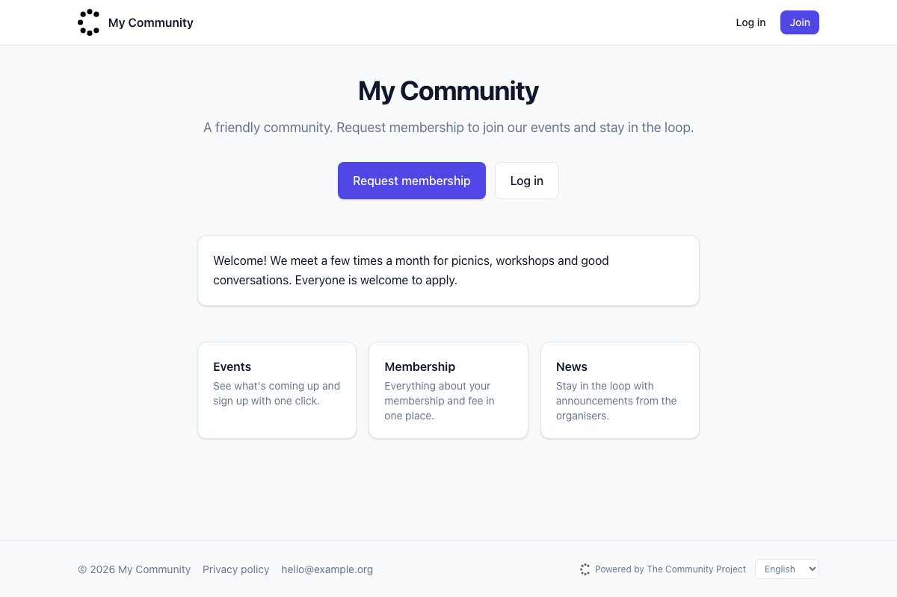
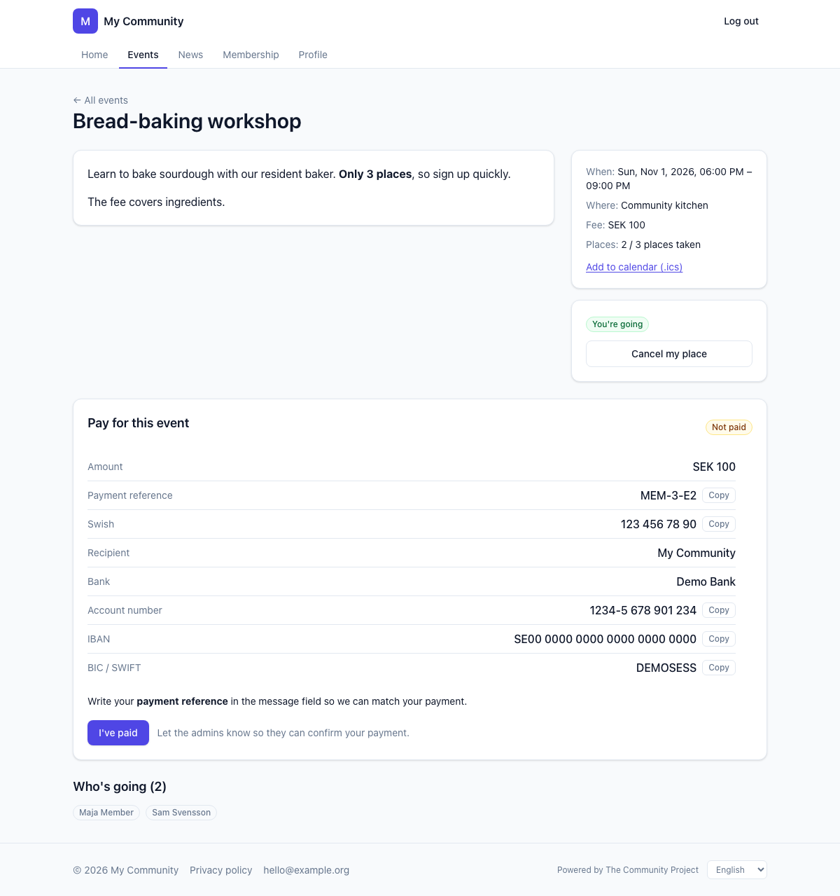
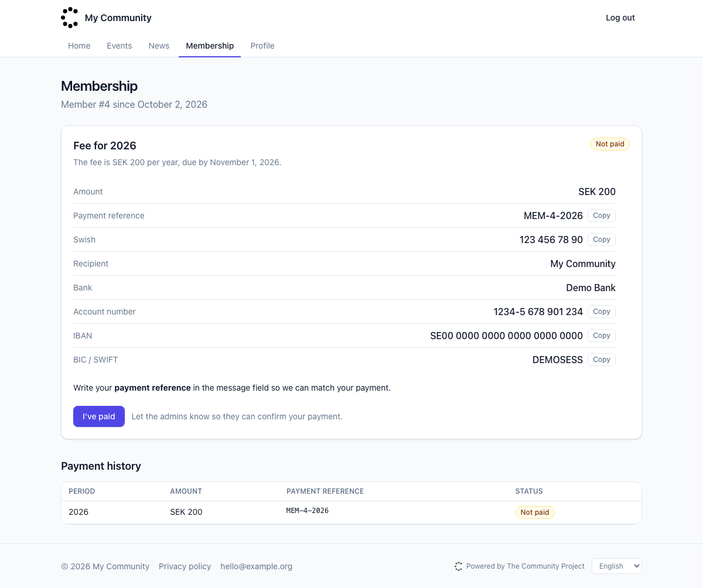
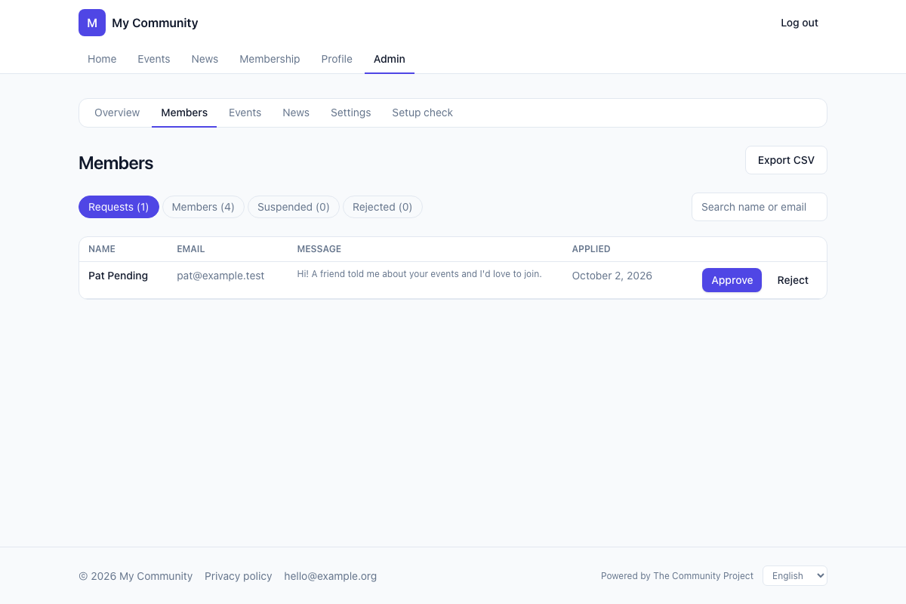
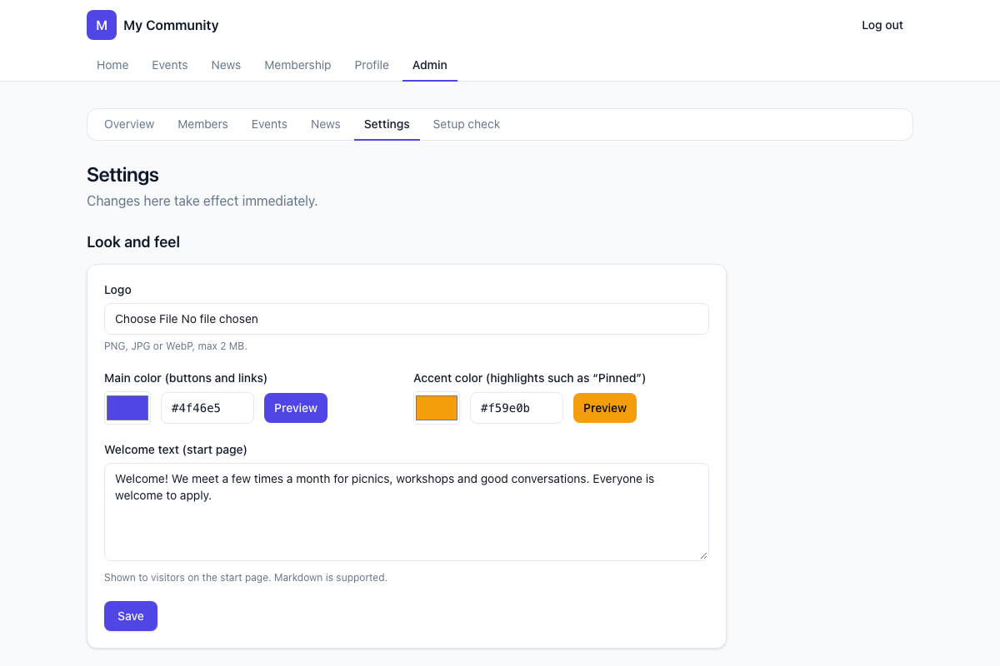
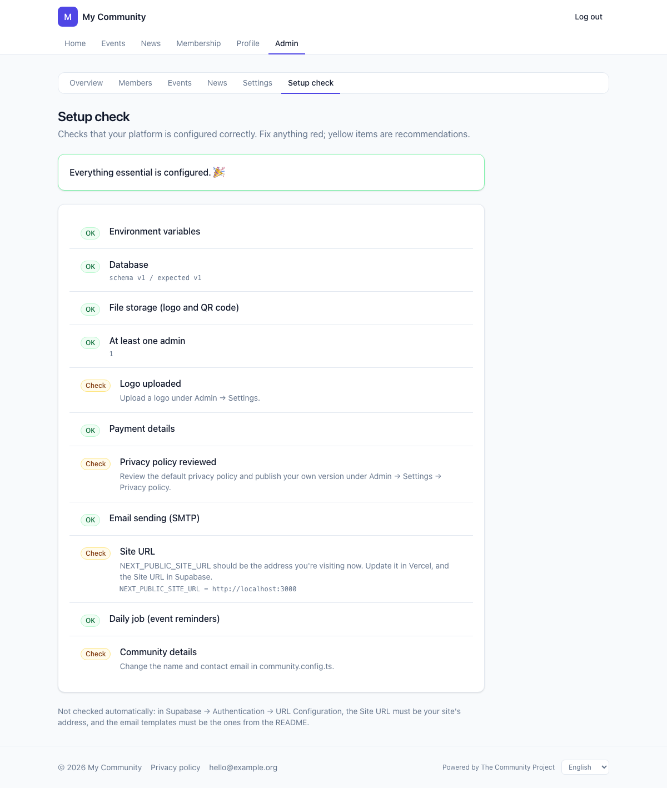

<p align="center"></p>

# The Community Project

**A free, open-source home for your community, run on your own accounts so you own the data.**

Many small communities (clubs, associations, groups of friends) organise everything through social media. The Community Project gives yours its own website instead:

- **Membership requests:** people apply, an admin approves them.
- **Passwordless login** with an email link or code.
- **Membership fees:** each member sees how to pay (bank account, IBAN, Swish, QR code) and a personal payment reference. Admins mark payments as received.
- **Events:** members sign up with one click. Optional capacity limits, sign-up deadlines and event fees. Calendar files (.ics) included.
- **News:** announcements, with comments from members.
- **Email notifications** for new members, approvals, new events, news and event reminders.
- **Admin tools:** member list, approvals, roles, payment tracking, CSV exports.
- **Privacy built in:** a public privacy policy you can edit. Members can download or delete their own data.
- **Your look:** your logo, colours and texts. English and Swedish included.

**You don't need to write any code.** You copy this project, fill in a few settings, and follow the steps below. It takes about an hour the first time.

| Start page | Event | Membership fee |
|---|---|---|
|  |  |  |
| **Admin: membership requests** | **Admin: settings** | **Admin: setup check** |
|  |  |  |

---

## Contents

1. [What it costs](#what-it-costs)
2. [Before you start](#before-you-start)
3. [Step-by-step setup](#step-by-step-setup) (steps 1–12)
4. [Am I done? Checklist](#am-i-done-checklist)
5. [Everyday use for admins](#everyday-use-for-admins)
6. [Changing settings later](#changing-settings-later)
7. [Keeping your copy up to date](#keeping-your-copy-up-to-date)
8. [Try it on your own computer first (optional)](#try-it-on-your-own-computer-first-optional)
9. [Troubleshooting](#troubleshooting)
10. [Security and privacy](#security-and-privacy)
11. [For developers](#for-developers)

---

## What it costs

| Service | What it does | Free plan |
|---|---|---|
| [GitHub](https://github.com) | Stores your copy of the code | Free |
| [Supabase](https://supabase.com) | Database, login and file storage | Free: 500 MB database, 1 GB files, 50,000 monthly users |
| [Vercel](https://vercel.com) | Runs the website | Free "Hobby" plan |
| An email provider, e.g. [Resend](https://resend.com) | Sends login links and notifications | Resend free: 3,000 emails/month, 100/day |
| Your own domain (optional) | e.g. `community.example.org` | ~€10–15/year from any domain registrar |

For most small communities this is **€0 per month**. Some limits to know about:

- **Supabase pauses free projects after a week without activity.** The daily job that sends event reminders also keeps the project active, so this normally won't happen. If it does, open the Supabase dashboard and click **Restore**.
- **Vercel's Hobby plan is for personal and non-commercial use.** If your community is a business, or the site makes money beyond covering costs, Vercel requires the Pro plan (about $20/month). If in doubt, check [Vercel's fair use policy](https://vercel.com/docs/limits/fair-use-guidelines).
- **Email limits.** The free plans are plenty for a few hundred members. If you send news to thousands of people, upgrade your email plan.

---

## Before you start

You'll need:

- [ ] **An email address you'll use as the first admin.**
- [ ] **A GitHub account:** [sign up](https://github.com/signup).
- [ ] **A Supabase account:** [sign up](https://supabase.com/dashboard/sign-up). Signing in with GitHub is easiest.
- [ ] **A Vercel account:** [sign up](https://vercel.com/signup). Choose "Continue with GitHub".
- [ ] **An email provider for sending email.** Resend is used as the example below. You'll need **a domain you control** (e.g. `example.org`) so Resend can send from it. Don't have one? See [Email without your own domain](#email-without-your-own-domain).
- [ ] About an hour, and a text file or password manager for **temporarily** keeping the values you collect. Delete that file at the end.

> **Keep these values secret:** the Supabase **secret key**, your email password or API key, and `CRON_SECRET`. Never put them in GitHub files, chat messages or screenshots. They only go into Vercel and Supabase settings.

---

## Step-by-step setup

### Step 1: Create your own copy on GitHub

1. Open the project page on GitHub: `https://github.com/Moralit-AB/the-community-project`.
2. Click the green **Use this template** button, then **Create a new repository**.
3. **Repository name:** e.g. `my-community`.
4. Choose **Private**, so only you (and people you invite) can see your copy.
5. Click **Create repository**.

> **Why "Use this template" and not "Fork"?** GitHub doesn't allow private forks of public projects. A fork works too, but it stays public. Both are fine, because no secrets ever go into the code.

**Recommended:** in your new repository, open **Settings → Advanced Security** (on some accounts it's called "Code security") and turn on **Secret Protection** and **Push protection** if they're available. They stop you from committing passwords by accident. (They're free for public repositories; for private ones it depends on your GitHub plan. The project's own checks protect you either way.)

### Step 2: Create a Supabase project

1. Go to the [Supabase dashboard](https://supabase.com/dashboard) and click **New project**.
2. **Name:** e.g. `my-community`.
3. **Database password:** click **Generate a password**. You won't need it again for this guide, but save it in your password manager.
4. **Region:** choose the one closest to your members (e.g. *Europe (Stockholm)* or *Central EU (Frankfurt)*).
5. Click **Create new project** and wait a minute or two until it's ready.

### Step 3: Create the database tables

1. In your Supabase project, open **SQL Editor** in the left sidebar.
2. Click **+ New query** (or the **+** tab).
3. On GitHub, open the file [`supabase/setup.sql`](supabase/setup.sql) in **your** repository. Click the **Copy raw file** button (two overlapping squares, top right of the file).
4. Paste everything into the Supabase SQL editor and click **Run**.
5. You should see **"Success. No rows returned"**. Supabase may first ask you to confirm because the script contains "destructive operations" (it doesn't delete anything; it creates the tables). Confirm to run it.

> Run this file **once**, on a new, empty project. If you run it twice you'll see "already exists" errors. Those are harmless, and nothing is lost.

### Step 4: Collect your Supabase keys

You'll paste these into Vercel in step 8. In your Supabase project:

1. Click **Project Settings** (gear icon) → **Data API**. Copy the **Project URL** (looks like `https://abcdefgh.supabase.co`).
2. Click **Project Settings → API Keys**. On the **"Publishable and secret API keys"** tab, copy:
   - the **Publishable key** (starts with `sb_publishable_`)
   - the **Secret key** (starts with `sb_secret_`). Click the eye icon to reveal it. **This is a secret.**

   If you don't see these, click **Create new API keys** on that page. The older "anon" and "service_role" keys also work, if those are all your project has.

### Step 5: Set up email sending

Supabase's built-in email only sends to your own team's addresses, so members would never get their login links. You need your own email provider. Here's how with **Resend**; any SMTP provider works the same way.

**5a. Verify your domain in Resend**

1. Sign up at [resend.com](https://resend.com).
2. Go to **Domains → Add Domain**. Enter your domain, or a subdomain such as `mail.example.org`, and choose a region near you.
3. Resend shows a few **DNS records** (TXT and MX). Add them where your domain's DNS is managed (your domain registrar, Cloudflare, etc.).
4. Back in Resend, click **Verify DNS Records**. It can take a few minutes, occasionally a few hours.

**5b. Create an API key**

1. In Resend, go to **API Keys → Create API Key**.
2. Name it `community`, set **Permission: Sending access**, and click **Add**.
3. Copy the key (starts with `re_`). **This is a secret.** You'll use it as the SMTP password.

**5c. Connect Supabase to Resend**

In Supabase, go to **Authentication → Emails → SMTP Settings**. Turn on **Enable custom SMTP** and fill in:

| Field | Value |
|---|---|
| Sender email | e.g. `hello@example.org`. It must be on the domain you verified. |
| Sender name | Your community's name |
| Host | `smtp.resend.com` |
| Port number | `465` |
| Minimum interval between emails | leave as is |
| Username | `resend` |
| Password | your Resend API key (`re_…`) |

Click **Save changes**.

Then go to **Authentication → Rate Limits** and set **Rate limit for sending emails** to at least `100` per hour. That allows many people to request login links at the same time, for example right after you announce the site.

Keep the same five values. Vercel needs them in step 8.

#### Email without your own domain

If you don't have a domain, use a provider that lets you verify a single sender address. Two options:

- [Brevo](https://www.brevo.com) (free: 300 emails/day): **SMTP & API → SMTP**. Host `smtp-relay.brevo.com`, port `587`, use the login and SMTP key it shows.
- **Gmail** with an [app password](https://support.google.com/accounts/answer/185833) (needs 2-step verification). Host `smtp.gmail.com`, port `465`, username = your Gmail address, password = the app password. Fine for small groups, about 500 emails/day.

Emails sent without your own domain are more likely to land in spam. If you can, get a domain.

### Step 6: Paste the login email template

The login email must contain a link in a specific format. Otherwise logging in won't work.

1. In Supabase, go to **Authentication → Emails → Templates**.
2. Open **Magic Link**:
   - **Subject:** `Your login link`, or in Swedish `Din inloggningslänk`.
   - **Body:** delete what's there. On GitHub, open [`supabase/templates/magic-link.en.html`](supabase/templates/magic-link.en.html) (Swedish: [`magic-link.sv.html`](supabase/templates/magic-link.sv.html)), copy the whole file and paste it in. Click **Save**.
3. Open **Confirm signup** and do exactly the same (same subject, same file). New members get this email the first time.

### Step 7: Personalise your community

In **your** repository on GitHub, open [`community.config.ts`](community.config.ts) and click the **pencil icon** (Edit). Change at least:

- `name`, your community's name
- `description`, a sentence or two for the start page
- `contactEmail`, a public contact address
- `membership.fee`: the amount, currency and how often members pay. Set the amount to `0` for free membership.
- `locales` and `defaultLocale`: which languages to offer (`"en"`, `"sv"`)
- `timezone`

Every setting is explained in the file. Click **Commit changes…** → **Commit changes**.

> Logo, colours, payment details and the privacy policy are **not** set here. You'll set them in the app in step 10.

### Step 8: Deploy on Vercel

1. In Vercel, click **Add New… → Project**.
2. Under **Import Git Repository**, find your repository and click **Import**. If it's not listed, click **Adjust GitHub App Permissions** and give Vercel access to it.
3. **Project Name:** e.g. `my-community`. Your site will be at **`https://my-community.vercel.app`**, so write that address down. If the name is taken, Vercel will tell you; pick another.
4. Open **Environment Variables** and add each of these. Tip: you can paste them all at once in `NAME=value` format.

| Name | Value | Where you got it |
|---|---|---|
| `NEXT_PUBLIC_SITE_URL` | `https://my-community.vercel.app` (no slash at the end) | Your project name from step 8.3 |
| `NEXT_PUBLIC_SUPABASE_URL` | `https://….supabase.co` | Step 4.1 |
| `NEXT_PUBLIC_SUPABASE_PUBLISHABLE_KEY` | `sb_publishable_…` | Step 4.2 |
| `SUPABASE_SECRET_KEY` | `sb_secret_…` 🔒 | Step 4.2 |
| `ADMIN_EMAILS` | your email address (several: separate with commas) | You |
| `SMTP_HOST` | `smtp.resend.com` | Step 5c |
| `SMTP_PORT` | `465` | Step 5c |
| `SMTP_USER` | `resend` | Step 5c |
| `SMTP_PASS` | `re_…` 🔒 | Step 5b |
| `SMTP_FROM` | `My Community <hello@example.org>` | Same sender as step 5c |
| `CRON_SECRET` | 32+ random letters and digits 🔒 | Generate one in your password manager, or run `openssl rand -hex 32` |

5. Click **Deploy** and wait for the confetti (2–3 minutes).
6. Click **Continue to Dashboard**. Under **Domains**, check the address. If it's different from what you put in `NEXT_PUBLIC_SITE_URL`, go to **Settings → Environment Variables**, fix `NEXT_PUBLIC_SITE_URL`, then go to **Deployments → ⋯ (on the latest) → Redeploy**.

### Step 9: Tell Supabase your site's address

1. In Supabase, go to **Authentication → URL Configuration**.
2. **Site URL:** your site address, e.g. `https://my-community.vercel.app`. Click **Save changes**.
3. **Redirect URLs:** click **Add URL** and add `https://my-community.vercel.app/**`.

> The links in login emails are built from the **Site URL**. If it's wrong, login links will lead to the wrong place.

### Step 10: Log in as admin and make it yours

1. Open your site and click **Log in**.
2. Enter the email from `ADMIN_EMAILS` and click **Send login link**.
3. Open the email and click **Log in**, or type the code. You're now the admin, and an **Admin** tab appears.
4. Go to **Admin → Setup check**. Everything should be green or yellow. Fix anything red: each item says how.
5. Go to **Admin → Settings**:
   - Upload your **logo** and pick your **colours**.
   - Write a **welcome text** for the start page.
   - Fill in your **payment details** (bank account, IBAN, Swish number, Swish QR code, and so on) and any instructions.
6. Go to **Admin → Settings → Edit privacy policy**. Read the default text, adapt it to your community, and click **Publish new version**. The default is a starting point, not legal advice.
7. Check **Admin → Setup check** again.

### Step 11 (optional): Use your own domain

1. In Vercel, open your project and go to **Settings → Domains → Add**. Enter e.g. `community.example.org` and follow the DNS instructions Vercel shows.
2. Once it works, update the address everywhere:
   - **Vercel:** set `NEXT_PUBLIC_SITE_URL` to `https://community.example.org`, then **Redeploy**.
   - **Supabase:** go to **Authentication → URL Configuration**, set the **Site URL** to the new address and add `https://community.example.org/**` to the **Redirect URLs**.

### Step 12: Invite your members

Share the link **`https://<your-site>/join`**. Here's what happens:
1. Someone fills in the form and confirms their email.
2. You get an email.
3. You approve them under **Admin → Members → Requests**.
4. They get an email, and can log in and see the payment details.

---

## Am I done? Checklist

- [ ] **Admin → Setup check** has no red items.
- [ ] You can log in with a login link, and with the code.
- [ ] Your logo, colours and payment details are set.
- [ ] The privacy policy is reviewed and published, and `/privacy` works while logged out.
- [ ] **Test member:** join with a second email address of yours, approve it, and log in as that member.
  - [ ] The member sees the fee with a personal reference, and can click **I've paid**.
  - [ ] As admin, you can confirm the payment.
- [ ] You can create and publish an event. The test member gets an email, can sign up, and is reminded the day before.
- [ ] You can post a news item, and the test member can comment.
- [ ] Switching language at the bottom of the page works.
- [ ] Your own domain works (if you set one up).

Done. Delete the temporary file with your keys, and delete the test member under **Admin → Members**.

---

## Everyday use for admins

| Task | Where |
|---|---|
| Approve or reject new members | **Admin → Members → Requests** (you also get an email) |
| See who has paid this period | **Admin → Members**, "Fee" column. Members who clicked "I've paid" show as *Reported*. |
| Confirm payments | Click **Confirm paid** per member, or **Confirm all reported** after checking your bank |
| Waive a fee | Open the member and click **Waive** |
| Make someone admin, suspend or delete a member | **Admin → Members → Manage** |
| Create an event | **Admin → Events → New event**. Tick **Published** when it's ready; members are emailed. |
| See who's coming or export a list | **Admin → Events →** the event → **Export CSV** |
| Post news | **Admin → News → New announcement** |
| Export all members | **Admin → Members → Export CSV** |

---

## Changing settings later

| What | How |
|---|---|
| Logo, colours, welcome text, payment details | **Admin → Settings**. Takes effect immediately. |
| Privacy policy | **Admin → Settings → Edit privacy policy**. Members are asked to read the new version. |
| Name, fee, languages, features, timezone | Edit `community.config.ts` on GitHub. Vercel redeploys automatically in a minute or two. |
| Admin emails, email provider, keys | Vercel → **Settings → Environment Variables**, then **Redeploy** |

All options are described in [docs/CONFIGURATION.md](docs/CONFIGURATION.md).

---

## Keeping your copy up to date

New versions of The Community Project bring fixes and features. Two ways to get them:

- **Automatic pull requests (recommended).** Your copy includes a workflow that opens a pull request with the latest changes once a month. Setup takes two clicks; see [docs/UPGRADING.md](docs/UPGRADING.md).
- **Manually.** Also described in [docs/UPGRADING.md](docs/UPGRADING.md).

Some updates include **database changes**. `docs/UPGRADING.md` lists them, and **Admin → Setup check** tells you if your database is behind.

---

## Try it on your own computer first (optional)

You can run the whole platform locally with demo data before you set anything up online. You don't need any accounts for this.

**You need:** [Node.js 22](https://nodejs.org) (or newer), [Docker Desktop](https://www.docker.com/products/docker-desktop/) running, and [Git](https://git-scm.com).

```bash
git clone https://github.com/Moralit-AB/the-community-project.git
cd the-community-project
npm install
npm run setup:local   # starts a local Supabase in Docker, creates the database and demo data, writes .env.local
npm run dev           # http://localhost:3000
```

| | |
|---|---|
| **App** | http://localhost:3000 |
| **One-click demo login** | http://localhost:3000/dev/login (admin, members, a pending applicant). Only exists locally. |
| **All emails sent locally** | http://localhost:54324 (Mailpit). Login links and notifications show up here. |
| **Database browser** | http://localhost:54323 (Supabase Studio) |

Useful commands:

```bash
npm run setup:local -- --reset   # start over with fresh demo data
npm run db:stop                  # stop the local Supabase containers
```

Change `community.config.ts` and the page updates as you save. When you're happy, follow the [setup steps](#step-by-step-setup) to go live.

> Port 3000 busy? Next.js picks 3001 automatically. Login links in local emails point to `localhost:3000`, so change the port in the address bar, or free port 3000.

---

## Troubleshooting

| Problem | Fix |
|---|---|
| **"Almost there: setup is incomplete"** page | `NEXT_PUBLIC_SUPABASE_URL` / `NEXT_PUBLIC_SUPABASE_PUBLISHABLE_KEY` are missing in Vercel. Add them and **Redeploy**. |
| **No login email arrives** | Check the spam folder. Then in Supabase, check **Authentication → Emails → SMTP Settings**, and that your domain is verified in Resend. Supabase → **Logs → Auth** shows errors. |
| **Login link says "expired or already used"** | Links work once and expire after an hour. Some email apps "pre-open" links. Use the **code** from the email instead. |
| **Login link leads to the wrong site / localhost** | Fix the **Site URL** in Supabase → Authentication → URL Configuration (step 9). |
| **The first admin isn't admin** | `ADMIN_EMAILS` must contain exactly that address. Fix it in Vercel, **Redeploy**, then log out and in again. |
| **The deployment fails with "community.config.ts is invalid"** | The error names the field. Fix it on GitHub; Vercel redeploys. |
| **The site is very slow, or Supabase says "paused"** | Supabase dashboard → your project → **Restore**. Check `CRON_SECRET` is set (step 8). |
| **Members don't get notification emails** | **Admin → Setup check → Email sending**. The `SMTP_*` values in Vercel must match your provider. |

More in [docs/TROUBLESHOOTING.md](docs/TROUBLESHOOTING.md).

---

## Security and privacy

- **Your data stays in your Supabase project.** No one else, including the authors of this project, has access.
- Every database table is protected by row-level security:
  - Members can see only what they should.
  - Only admins can approve members or change roles. This is enforced in the database itself and covered by automated tests.
- No passwords: login is by one-time email links or codes.
- Members can download and delete their own data from their profile page.
- The code repository never contains secrets. A built-in check blocks commits that look like they contain keys.
- Found a vulnerability? Please report it privately; see [SECURITY.md](SECURITY.md).

---

## For developers

- **Stack:**
  - Next.js 16 (App Router, React 19) and Tailwind CSS v4
  - Supabase: Postgres + RLS, Auth, Storage
  - next-intl, nodemailer, zod
  - Vitest, pgTAP and Playwright for tests
- **Architecture, conventions and commands:** [CLAUDE.md](CLAUDE.md)
- **Current status:** [HANDOFF.md](HANDOFF.md)
- **How to contribute:** [CONTRIBUTING.md](CONTRIBUTING.md)

```bash
npm run setup:local && npm run dev   # local stack with demo data
npm test                             # unit tests
npm run db:test                      # database security tests (pgTAP)
npm run e2e                          # end-to-end tests (Playwright)
```

## License

[MIT](LICENSE). Use it, change it, share it.
